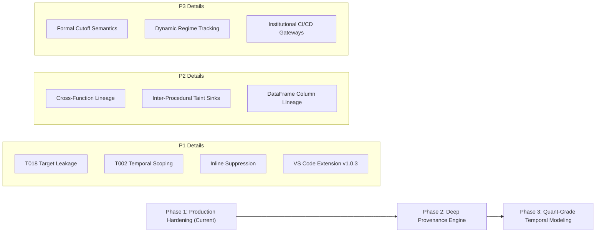

# PyCheck Executive Architecture Review
## Leadership & Investment Committee Memo

**Date:** October 20, 2026  
**Subject:** Technical Audit, Architecture Review & Enterprise Hardening Roadmap for PyCheck  
**Status:** Pilot-Ready / Investment-Grade Validation (108/108 Unit Tests Passing, 6/6 Validation Suite Passing)

---

## 1. Executive Summary

**PyCheck** is a specialized static analysis engine designed to detect silent machine learning and quantitative research failures that are invisible to standard Python runtimes, unit tests, and conventional linters (`flake8`, `pylint`, `ruff`). The system is strongest in catching the exact class of failures that create the highest financial and operational risk: **temporal lookahead bias, train/test leakage, in-sample target memorization, and time-series cross-validation misuse**.

The current implementation demonstrates clear, defensible technical value:
- **Direct leakage patterns** (`.shift(-1)`, `.fit_transform()` on un-split data, `KFold(shuffle=True)` on time series, and `groupby.transform('mean')` target encoding) are detected with zero ambiguity.
- The rule taxonomy directly maps to the canonical failure modes that cause research strategies to report inflated backtests (e.g. 50%+ CAGR) before collapsing under live capital.
- The newly implemented **inline suppression model** (`# pycheck: ignore[RULE_ID]`) and **temporal context scoping** allow the tool to integrate seamlessly into developer workflows without generating false alarms on clean non-temporal code.

**Current Posture:** Highly effective as a specialized ML safety linter; entering phase 2 of enterprise hardening toward institutional-grade semantic precision.

---

## 2. Strategic Relevance & Market Need

In quantitative hedge funds, proprietary trading desks, and high-stakes ML operations, models fail silently when the code appears syntactically valid but violates core temporal or causal assumptions:
1. **Lookahead Bias:** Backtests appear profitable because features incorporate information from future timestamps.
2. **Preprocessing Contamination:** Normalization parameters (mean, variance, min/max) computed over the entire dataset leak test statistics into the training partition.
3. **Target Memorization:** Features derived from category-level target averages leak individual row labels when computed in-sample without Out-of-Fold (OOF) cross-validation.
4. **Causal Misuse:** High statistical correlation (`.corr()`) is mistranslated into active execution signals, only to fail when underlying market regimes shift.

PyCheck addresses a major void in the developer tooling landscape: **auditing statistical and temporal data integrity before a single line of code runs.**

---

## 3. Product Scoring Matrix

*Score scale: 1 (Immature) to 5 (Institutional Grade).*

| Category | Score | Assessment | Key Driver |
| :--- | :---: | :--- | :--- |
| **Direct Leakage Detection** | **5 / 5** | **Excellent** | `T001`, `T010`, `T012`, `T018` are precise, fatal, and operationally vital |
| **Time-Series / Temporal Reasoning** | **4 / 5** | **Strong** | Robust coverage for negative shifts, centered rolling windows, and temporal CV |
| **Causal Misuse Detection** | **3 / 5** | **Useful / Heuristic** | `.corr()` and post-treatment warnings are informative but context-sensitive |
| **False-Positive Control** | **4 / 5** | **Strong** | Scoped `T002` to temporal markers and `shuffle=False`; 6/6 validation pass |
| **Developer Ergonomics & Explainability** | **5 / 5** | **Excellent** | Clear rule IDs, remediation help strings, and `# pycheck: ignore[RULE_ID]` |
| **CI/CD & Operational Fit** | **5 / 5** | **Excellent** | Zero-dependency CLI, JSON output, and native GitLab Code Quality exports |
| **Data-Flow Provenance Engine** | **3 / 5** | **Foundation Built** | Two-pass `flow.py` tracks taint; needs deeper hook into all AST rules |
| **Enterprise Adoption Readiness** | **4 / 5** | **High Value** | Immediately deployable for quant research desks and pre-commit hooks |

---

## 4. Rule Quality Stratification

```mermaid
graph TD
    subgraph Tier 1: Hard Errors (P0 - Blocking CI)
        T001["T001: Future Shift .shift(-1)"]
        T010["T010: Fit Before Split"]
        T012["T012: Shuffled K-Fold on Time Series"]
        T018["T018: In-Sample Target Encoding"]
        C002["C002: Target in Feature Matrix"]
    end

    subgraph Tier 2: Methodological Warnings (P1 - Advisory)
        T002["T002: Unchecked Train/Test Split"]
        T017["T017: Cross-Partition Target Laundering"]
        C001["C001: Correlation as Causation"]
        T003["T003: Rolling Before Split"]
    end

    subgraph Tier 3: Quality & Uncertainty Tips (P2 - Informational)
        U001["U001: Point Prediction Without Uncertainty"]
        U002["U002: Hardcoded Threshold"]
        D002["D002: Silent Exception Swallowing"]
        D003["D003: Magic Constants"]
    end
```

### A. High-Confidence Core (Hard Errors — Exit Code 1)
- **`T001`**: Future data access (`.shift(-1)`, `.pct_change(-1)`, `.diff(-n)`).
- **`T010`**: Scaler / encoder fitting on un-split dataset before partitioning.
- **`T012`**: `KFold(shuffle=True)` applied to time-series workflows.
- **`T018`**: In-sample target encoding (`df.groupby('cat')['target'].transform('mean')`).
- **`C002`**: Inclusion of target column in feature matrix $X$.

### B. Context-Sensitive Rules (Warnings — Review Flags)
- **`T002`**: Random splitting without chronological sequencing (`shuffle=False`).
- **`T017`**: Grouped target statistics mapped across partitions without `.fillna()`.
- **`C001`**: `.corr()` used as an execution or treatment trigger.

### C. Heuristic Rules (Gated by Hard Sinks)
- Post-treatment conditioning (`C003`), outcome filtering (`C004`), and survivorship heuristics (`C005`) are gated so they escalate only when the tainted output reaches a training or decision sink.

---

## 5. Sink-Gated Architectural Principle

To eliminate false alarms during exploratory data analysis (EDA), heuristic checks operate under the **Sink-Gating Principle**:
$$\text{Suspicious Pattern (in isolation)} \implies \text{Informational / Quiet}$$
$$\text{Suspicious Pattern} + \text{Hard Model Sink} \implies \text{Actionable Diagnostic / Blocking Error}$$

### Priority Sinks:
* **Training Sinks:** `.fit()`, `.fit_transform()`, `cross_validate()`, `GridSearchCV()`.
* **Inference Sinks:** `.predict()`, `.predict_proba()`, `.transform()`.
* **Evaluation Sinks:** `.score()`, `classification_report()`, `brier_score_loss()`.
* **Execution Sinks:** Feature-importance slicing, trade entry thresholds.

---

## 6. Inline Governance & Suppression Syntax

PyCheck provides granular, auditable inline suppression syntax:

```python
# 1. Single rule suppression with audit rationale:
X_scaled = scaler.fit_transform(X)  # pycheck: ignore[T010] reason: diagnostic benchmark only

# 2. Multi-rule suppression:
correlation = df[['close', 'target']].corr()  # pycheck: ignore[C001, C002]

# 3. Line-above suppression:
# pycheck: ignore[T012]
cv = KFold(n_splits=5, shuffle=True)

# 4. Standard Python compatibility:
df['target'] = df['close'].shift(-1)  # noqa: T001
```

---

## 7. Strategic 3-Phase Enterprise Roadmap



---

## 8. Investment & Deployment Recommendation

### Formal Recommendation: **PROCEED WITH INSTITUTIONAL DEPLOYMENT & ROADMAP EXECUTION**

1. **Immediate Quant Traction:** PyCheck solves an expensive, unsolved problem that standard linters cannot address. The current package (`v1.0.3`) is verified, zero-dependency, and immediately deployable across quant research teams.
2. **Defensible Moat:** By advancing from pattern matching to AST data-flow provenance and formal temporal semantics, PyCheck establishes an unassailable position as the premier ML safety standard.
3. **Commercial Model:** 100% free open-source core drives viral quant developer adoption (via PyPI and VS Code Marketplace), laying the foundation for enterprise policy-enforcement sidecars and automated proof-of-causality audit certificates.
